<div align="center">

# 🚌 Wrap 2026

### Your year on the road, replayed one trip at a time.

A year-in-travel story for every redBus traveller: buses, trains and hotels, told in
animated cards that are **different for every single user**.

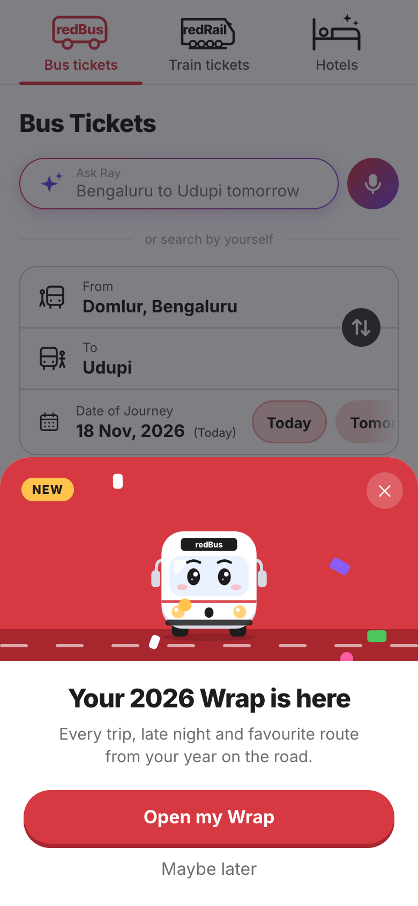
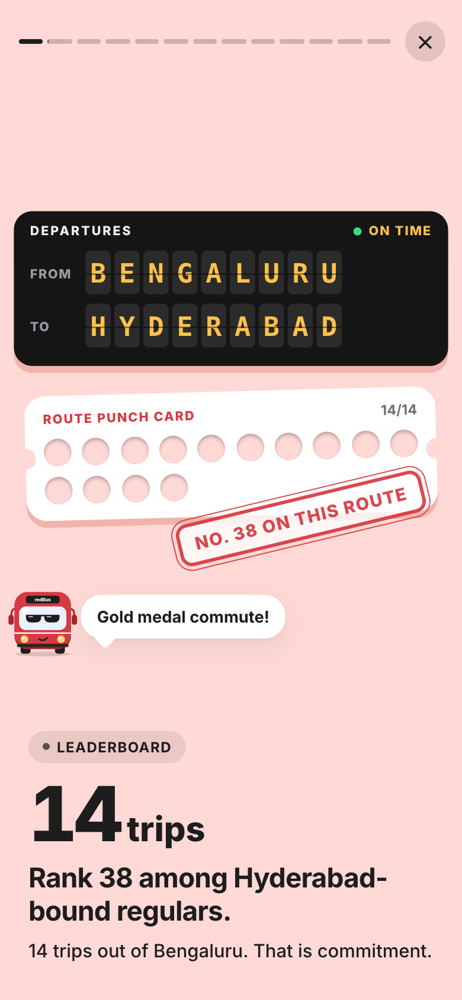
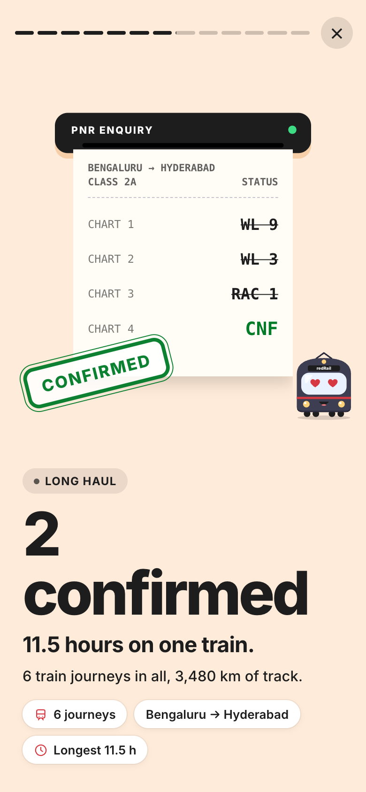

</div>

---

## ✨ What's inside

| | |
|---|---|
| 🎲 **No two wraps alike** | Card mix, order, copy, layout, colours and mascot mood are picked per user. Two travellers with near-identical data still share **zero** headlines. |
| 🚆 **Bus, train and hotel** | Departure boards, punch cards, PNR slips that climb from WL to CNF, sleeper berths, hotel key cards, lit-up skylines and luggage tags. |
| 🔢 **Numbers you can trust** | The copy never writes a number itself. Every figure comes from the data through a slot, and the composer rejects anything else. |
| 🔌 **Real data, safely** | The server fetches each user's row from the data API with a server-side token, adapts it and serves ready-to-draw pages. The app never sees the token. |
| 📱 **Lands where users already are** | Opens on the redBus mobile home with a "Your 2026 Wrap is here" sheet. |

## 📸 The cards

<table>
<tr>
<td align="center">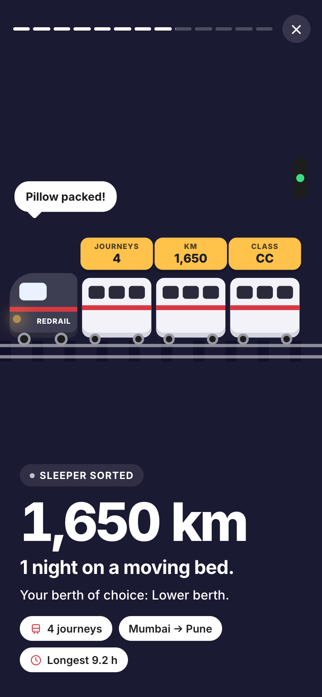<br/><sub><b>Train · coaches</b><br/>a stat on every coach</sub></td>
<td align="center">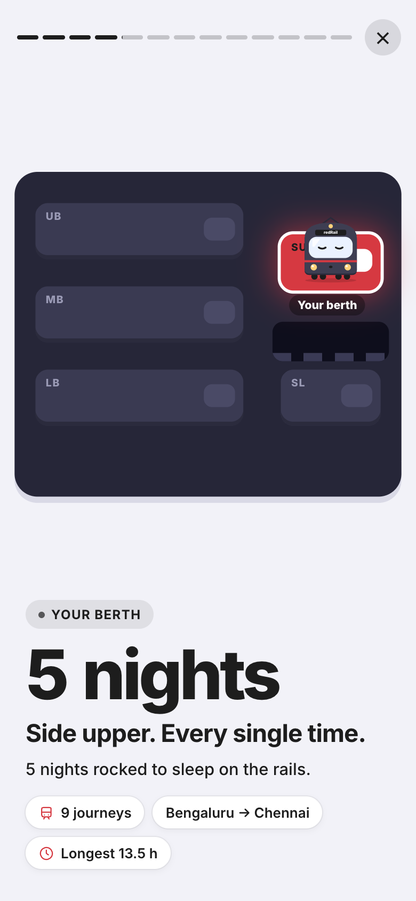<br/><sub><b>Train · berth</b><br/>your berth lights up</sub></td>
<td align="center"><br/><sub><b>Train · PNR slip</b><br/>WL → RAC → CNF</sub></td>
<td align="center">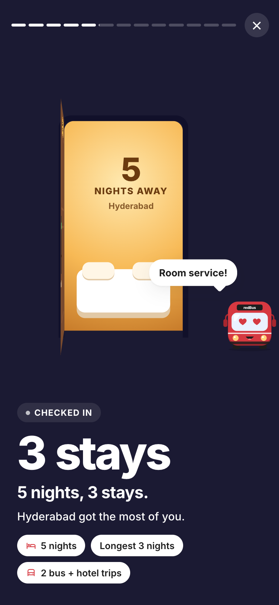<br/><sub><b>Hotel · key card</b><br/>the door swings open</sub></td>
</tr>
<tr>
<td align="center">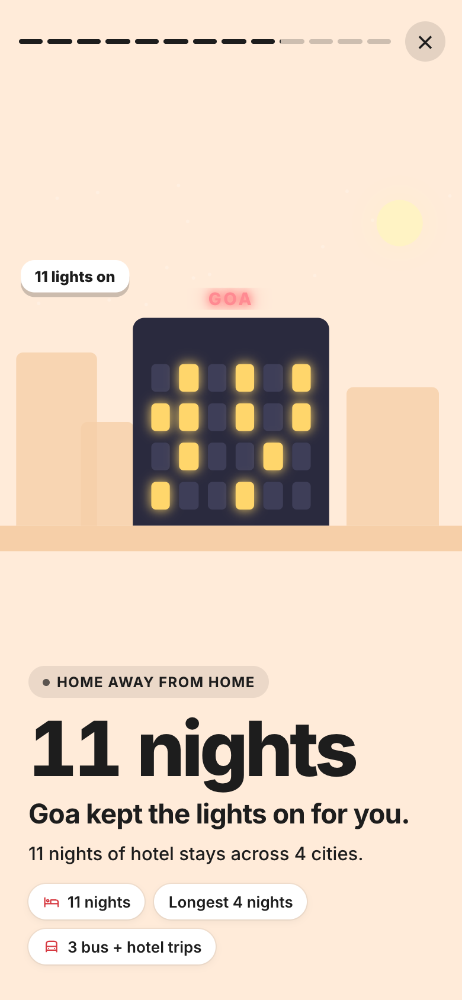<br/><sub><b>Hotel · skyline</b><br/>one window per night</sub></td>
<td align="center">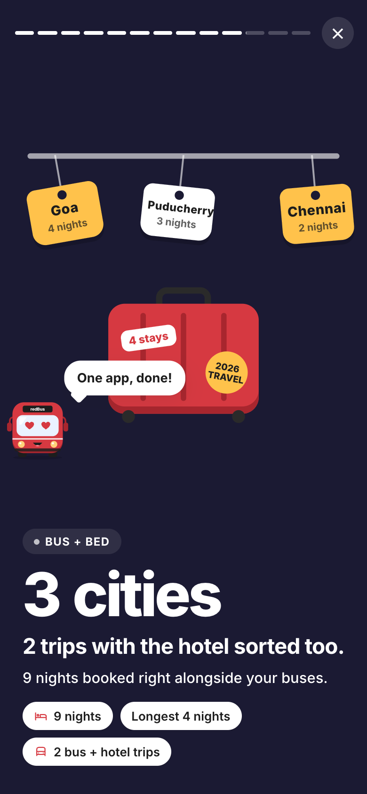<br/><sub><b>Hotel · luggage</b><br/>a tag for every city</sub></td>
<td align="center"><br/><sub><b>Top route</b><br/>departure board + punch card</sub></td>
<td align="center">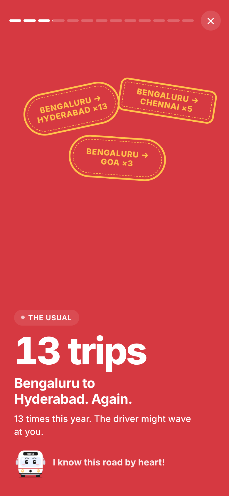<br/><sub><b>Top route · passport</b><br/>routes as stamps</sub></td>
</tr>
<tr>
<td align="center">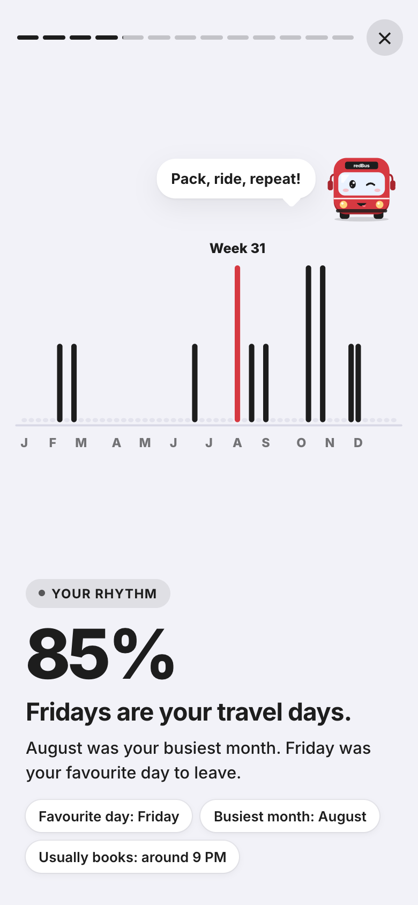<br/><sub><b>Rhythm</b><br/>52 weeks at a glance</sub></td>
<td align="center">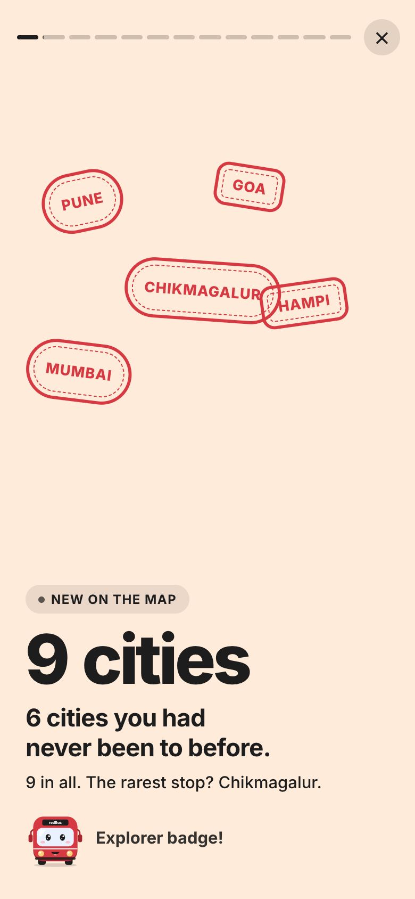<br/><sub><b>Places</b><br/>cities as passport stamps</sub></td>
<td align="center">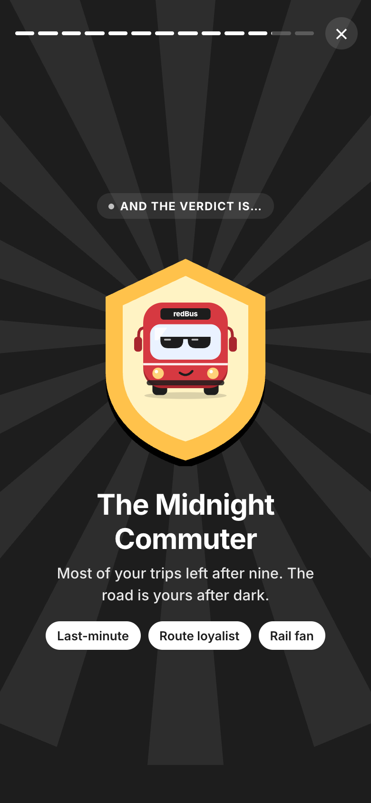<br/><sub><b>Persona</b><br/>your travel personality</sub></td>
<td align="center"><br/><sub><b>Landing</b><br/>the Wrap is waiting</sub></td>
</tr>
</table>

## 🚀 Run it

```bash
npm install
npm run dev        # API on :8787 + web app on :5173
```

Then open **http://localhost:5173/?rbUserId=1**. The redBus home loads, the Wrap sheet
slides up, and "Open my Wrap" plays it.

| Try | What you get |
|---|---|
| `/?rbUserId=1` · `2` · `3` | **Rohan, Priya, Dev**: full wraps with bus, train *and* hotel cards |
| `/?rbUserId=42` | Any ID up to 400: a dummy traveller generated from the ID (same ID, same wrap) |
| `/?rbUserId=11` … `14` | Classic demo wraps (Aarav, Meera, Zoya, Kabir) |
| `/?rbUserId=15` | No trips this year (422 screen) |
| `/?rbUserId=401` | User not found (404 screen) |
| `/?picker` | Dummy-user picker |
| `/?rbUserId=1&page=7&hold` | QA: jump to a card and pause auto-advance |

### Meet the showcase travellers

| | Bus | Train | Hotel |
|---|---|---|---|
| **1 · Rohan** | Bengaluru ⇄ Hyderabad night commuter, 26 trips | 6 journeys, a WL 9 → CNF climb | 5 nights in Hyderabad and Chennai |
| **2 · Priya** | Rohan's near-twin, 24 trips | 9 journeys, sleeps on the side upper | 9 nights across Goa, Puducherry, Chennai |
| **3 · Dev** | Pune weekend wanderer, 13 trips, 9 cities | 4 journeys, Mumbai ⇄ Pune in CC | 11 nights across 4 cities |

Rohan and Priya have almost the same bus data, and still get different openings, orders, copy and looks.

## 🖼️ Variant gallery and sound

Open **http://localhost:8787/?gallery** to see every card in every look: 20 cards, 226 looks.

- **Many ways to draw one number.** Besides each card's own animation, any card can use a set of generic layouts when its data fits them: speedometer, odometer rollers, departure board, scratch card, trophy, icon grid, receipt, columns, road trip, chat, polaroids, podium, postcard, year calendar. The rules for which data each layout needs are in [`server/wrap/layouts.mjs`](server/wrap/layouts.mjs).
- **Pick for prod.** Tick the looks production may use and press **Save picks**. The picks go to [`server/wrap/selection.mjs`](server/wrap/selection.mjs). A card with nothing ticked keeps all its looks in rotation.
- **Play the decks.** **▶ Play all looks** plays every look back to back, and **▶ Play** next to a card plays only that card's looks. Add `&show=TOP_ROUTE.gauge` to the URL to open one look full size.
- **Sound.** A soft background loop plays, plus effects timed to the animations: flaps, stamps, ticks while numbers count up, a printer, a train horn, a key card beep. It's all synthesised with Web Audio in [`src/lib/sound.ts`](src/lib/sound.ts), so there are no audio files. Audio starts on the first tap, the 🔊 button mutes it, and the gallery previews stay silent.

## 🎲 How every wrap becomes unique

```
data API row ──▶ adapter ──▶ composer ──────────────────────────────▶ WrapResponse ──▶ app
 (69 columns)   facts.mjs    1. eligible cards (thresholds, nulls)      ordered pages,
                             2. score + seeded jitter                   copy, numbers,
                             3. pick a varied deck (no repeat families) variant per page
                             4. variant per card: framing × copy × layout
                             5. personalised order + palette + mascot mood
                             6. fill {slots}, reject numbers not from data
```

- **Seeded by `rb_user_id`.** The same user always gets the same wrap, and different users get different ones.
- **Balanced across a batch.** Users who share a card read different words first, then see a different look.
- **Tested.** `npm run test:variety` runs 8,800+ checks: decks are deterministic and well formed, no layout repeats inside a deck, every layout has data to draw, real-API quirks are handled, and 150 generated users all come out valid.

The design behind it is in [`docs/card-variations-design.md`](docs/card-variations-design.md).

## 🔌 Data

- **Bus:** the data serving API returns one 69-column row per user
  (`GET {WRAP_DATA_API_URL}/wrap/{rb_user_id}`, bearer token). The server fetches it,
  adapts it in [`server/wrap/facts.mjs`](server/wrap/facts.mjs), composes the wrap and caches it for 10 minutes.
  - **Adapter handles:** route formats, city spellings (Bangalore/Bengaluru),
    `(area)` names, ISO dates, nullable columns, the six archetypes and the week-number heatmap.
- **Train and hotel:** *proposed*. No feed exists yet, so they come from
  [`server/data/dummyExtras.mjs`](server/data/dummyExtras.mjs). That file also defines the fields a future feed should provide.
- **Contract:** [`contract/india_bus_wrap_2026.table.json`](contract/india_bus_wrap_2026.table.json) is the table definition.
  `npm run gen:contract` regenerates the `PipelineRow` schema and the column types from it,
  and the server logs any drift in real rows.

```bash
cp .env.example .env     # WRAP_DATA_API_URL + WRAP_DATA_API_TOKEN (server-side only, gitignored)
```

IDs up to 400 are dummy users; anything above goes to the real API (`WRAP_DUMMY_MAX_ID=0` sends everything).

## 📜 The API

```http
POST /api/v1/wrap
{"userId": 42}
```

| Status | When |
|---|---|
| 200 | The wrap: `user`, ordered `pages[]`, `share` card |
| 400 | Body isn't exactly `{"userId": <positive integer>}` |
| 404 | No such user |
| 422 | No trips this year |
| 502 | The data API is down or rejected the token |

Each page is `{ id, type, dwellMs, copy, data, variant }`:
- **`type`** picks the renderer. Unknown types are skipped, so new cards can ship server-first.
- **`variant.layout`** picks the look.
- **`dwellMs`** starts only after the animation reports it has finished.

Specs: [`contract/openapi.yaml`](contract/openapi.yaml) (browse it at `/api/docs`),
[`src/contract.ts`](src/contract.ts) and [`contract/WrapContract.kt`](contract/WrapContract.kt).

## 🧰 Scripts

| Command | Does |
|---|---|
| `npm run dev` | Dummy API + Vite dev server |
| `npm start` | Build, compose, serve app + API on :8787 |
| `npm run compose` | Batch-compose the stored wraps |
| `npm run test:variety` | Uniqueness, determinism and data-quirk checks |
| `npm run test:api` | Request validation and classic page rules |
| `npm run gen:contract` | Regenerate the row contract from the table definition |
| `npm run docker:build` | Build the app and a small runtime image (`wrap-2026`) |

## 🗺️ Code map

```
contract/                OpenAPI spec, Kotlin data classes, table definition
server/wrap/facts.mjs    adapter: data API row → facts
server/wrap/cards.mjs    the variant library: every card, framing, copy and layout
server/wrap/compose.mjs  the composer: select, assign, order, fill, check
server/wrap/dataApi.mjs  data API client (server-side token, cache)
server/data/             sample rows, dummy generators, city coordinates
src/landing/             redBus home replica + Wrap popup
src/pages/               renderers: topRoute, train, stay, insight, classic pages
```

## 🐳 Deploy

```bash
npm run docker:build
docker run -d --name wrap-2026 -p 3000:3000 --env-file .env wrap-2026
```

The image only holds the built app and the server, which uses Node built-ins and has no npm
dependencies. The `.env` file is passed in at run time and never baked into the image.

On a host without Docker but with k3s, load the image into its own containerd namespace
and run it there. No Kubernetes objects are created:

```bash
sudo k3s ctr -n wrap images import --platform linux/arm64 wrap-2026-image.tar
sudo systemctl restart wrap-2026      # unit runs: k3s ctr -n wrap run --net-host --env-file … wrap-2026
```

Build the image on a laptop if npm inside Docker can't reach the registry (for example behind HTTPS inspection).

## 🎬 Moving the animations to Rive

Each page component is a reference for one Rive artboard:
- **Numbers:** values in `data` become state-machine inputs.
- **Text:** `copy` stays native, so it localises without new Rive files.
- **Settling:** when the state machine reaches its end state, fire the same
  "settled" signal as `src/lib/settle.ts`, then start the `dwellMs` timer.

---

<sub>All travellers and numbers in this repo are sample data. The India outline is a
simplified shape; swap in the approved map asset before anything leaves the team.</sub>
